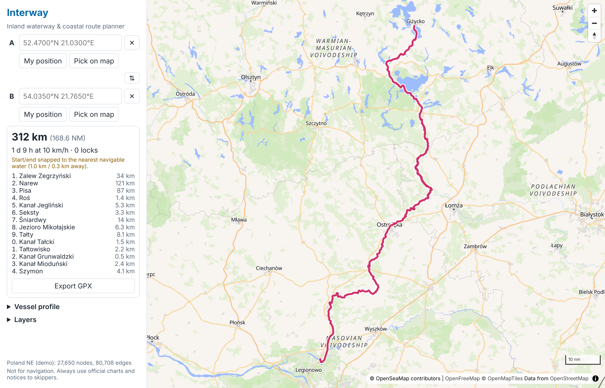

# Interway

A web chartplotter with route planning for **inland waterways** (and later the coast). It works like
Google Maps for boats: pick A (your GPS position, a map click or a search result) and B, and get a
navigable route over rivers, canals and lakes, with distance, ETA, locks and vessel limits.



*Not for navigation.* Use it alongside official charts and notices to skippers.

## How it works

- **Data:** OpenStreetMap only (rivers, canals, lakes, locks, bridges, marinas). Basemap from OpenFreeMap,
  seamarks from OpenSeaMap, search from Photon. No API keys.
- **Pipeline** (`pipeline/`, Python): OSM extract → navigable waterway graph → static binary files
  (`graph.bin`, `geom.bin`, `manifest.json`, `pois.json`; spec in [docs/graph-format.md](docs/graph-format.md)).
  - navigability from OSM tags (`CEMT`, `boat`, `ship`, `motorboat`, fairways, locks) plus per-country
    allowlists in [`data/navigable/`](data/navigable/README.md)
  - lakes and reservoirs (no centre lines in OSM) become routable through a triangulated navigation mesh;
    touching lakes are merged, so chains like the Great Masurian Lakes connect
  - weirs/dams cut waterways, bridge clearances limit air draft, river direction gives up/downstream speed
  - short unverified channels between lakes are added as connectors (flagged)
- **App** (`app/`, React + TypeScript + MapLibre): routing runs **in the browser** (Web Worker, A\*) on the
  downloaded graph, so it can work offline. Vessel profile (speed, draft, air draft, beam, length, lock
  penalty), route summary and legs, GPX export, shareable URLs (`?from=lon,lat&to=lon,lat`). Place search finds
  marinas, ports, locks and towns in the downloaded data at once and offline; Photon adds the rest when online.
- **Maps-app layout:** a full-screen map with a floating search box (saved and recent places), category chips
  (marinas, harbours, fuel, locks, slipways, water, toilets: the nearest to the map centre), and a sheet for the
  rest: a draggable bottom sheet on phones, a folding side panel on desktop. Tap a lock or marina, long-press (or
  right-click) to drop a pin, then Directions / Start here / Save / Share. The directions card has boat-type chips
  (small boat, motor cruiser, sailboat, narrowboat, custom). Round buttons for layers (day / night / auto map) and
  your position; "/" focuses search, Esc closes. Installable as an app.
- **Route options:** up to two other reasonable routes (mostly different, at most 40 % slower) are drawn in grey with
  their times; tap one on the map or in the summary to take it.
- **Navigation mode:** the map follows the boat heading up; a green banner shows the next lock or bridge and its
  distance, a bottom bar the time and distance to go and the arrival time, with speed and course over ground and
  cross-track error above it. Off the route it re-plans from the
  boat's position, and it keeps the screen on (Screen Wake Lock). It warns (vibration, optionally voice) 1 km and
  200 m before each lock and bridge, and records the track for GPX export. "Save map for offline" stores the basemap
  and seamark tiles along a route.

The full plan and roadmap are in [docs/PLAN.md](docs/PLAN.md).

## Running

```bash
cd app
npm install
npm run dev            # http://localhost:5173  (uses the data in app/public/data)
npm test               # unit tests
```

The repository ships the graph for Poland, Germany, the Netherlands, Belgium, Switzerland, France, the UK's
rivers and canals, Austria, Czechia, Slovakia, the Danube countries (Hungary, Croatia, Serbia, Romania, Bulgaria),
northern Italy (the Po and the Venetian waterways), Ireland (Shannon, Erne, Grand and Royal canals), Sweden (Göta
and Trollhätte canals, Vänern, Vättern, Mälaren), Finland (the Saimaa lakes and their canals), Lithuania (Nemunas,
Curonian Lagoon), Spain (Guadalquivir, Ría de Bilbao) and Portugal (Douro, Tejo, Guadiana), joined by a sea network from the Atlantic to the Black Sea: enough for
routes like Zalew Zegrzyński → Mazury, Wrocław → Amsterdam, the Baltic → Mediterranean "Le Cut", the Grand Union Canal,
Vienna → the Black Sea, Gdańsk → Venice, Dublin → the Shannon or London → Crete.
Try `http://localhost:5173/?from=17.035,51.115&to=4.90,52.38`.

## Deployment

`.github/workflows/pages.yml` builds the app and deploys it to GitHub Pages on every push to `main`
(`https://<owner>.github.io/<repo>/`). One-time setup: repository **Settings → Pages → Source: GitHub Actions**.
The build sets `VITE_BASE=/<repo>/` so the app, its data and the service worker live under that path.

## Building waterway data

```bash
cd pipeline
pip install -e '.[dev]'
# Country/region extracts from https://download.geofabrik.de or https://download.openstreetmap.fr.
# Where neither is reachable, cut a bounding box out of the streamed Europe file (needs osmium-tool):
#   tools/stream-extract.sh https://ftp5.gwdg.de/pub/misc/openstreetmap/download.geofabrik.de/europe-latest.osm.pbf \
#     13.4,41.2,29.9,48.7 danube.osm.pbf && interway-filter danube.osm.pbf -o filtered/
python -m interway_pipeline.cli poland.osm.pbf germany.osm.pbf netherlands.osm.pbf \
    --region "PL-DE-NL" -o ../app/public/data --cache cache/
pytest -q

# check the canonical routes in data/test-routes.yaml against the result
cd ../app && INTERWAY_DATA=public/data npm run test:routes
```

`qa-components.json` in the output lists the disconnected parts of the network. Fix gaps by adding
names to `data/navigable/*.yaml` or connectors to `data/patches/*.geojson` (LineStrings whose ends snap to
the network).

## Status

- [x] Phase 0: app scaffold, map, GPS, A/B picking, search
- [x] Phase 1: pipeline v1, lake mesh, Zegrze → Mazury routes in the browser
- [ ] Phase 2: Germany + Netherlands + rest of Europe (Wrocław → Amsterdam), tiled geometry
- [x] Phase 3: lock/bridge details on the map, offline search
- [x] Offline (PWA): app, waterway data and viewed map tiles cached by a service worker
- [x] Phase 4: navigation mode
- [x] Phase 5: sea routing (coastal mesh, EMODnet depth)
- [x] Phase 6: maps-app interface (search, places, bottom sheet, directions card, navigation banner)
- [x] Phase 7: alternative routes

## License and attribution

Map data © OpenStreetMap contributors (ODbL). Seamarks © OpenSeaMap contributors.
